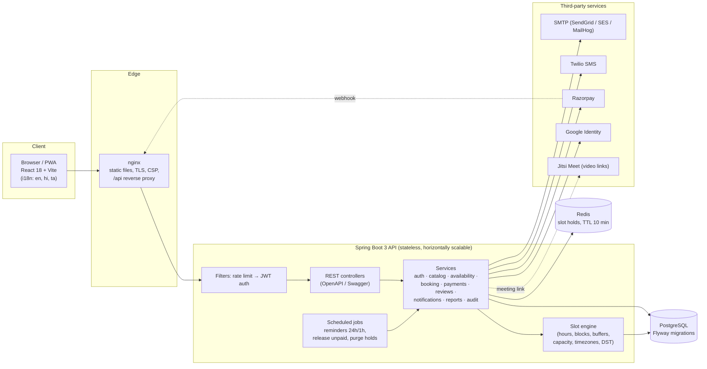
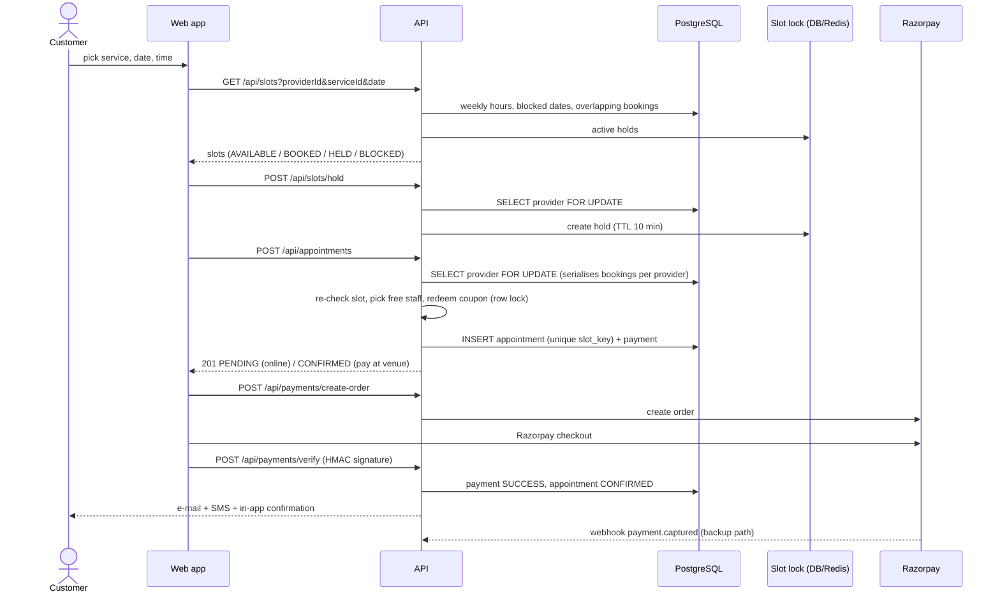
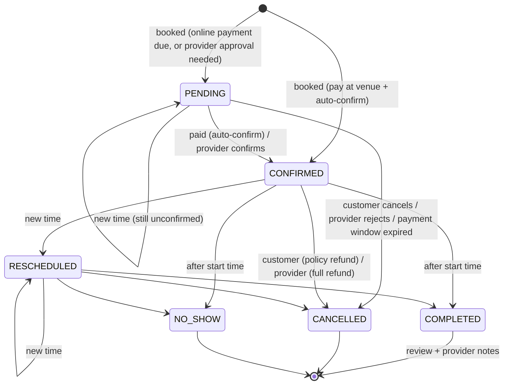

# Architecture

## System overview

## Booking sequence (race-safe, FR-20..24)

Double booking is prevented at three levels:
1. **Pessimistic lock** on the provider row for every write that consumes capacity (hold, book, reschedule).
2. **Re-validation** of the requested time against live data inside that transaction.
3. **Database unique constraint** on `appointments.slot_key` (`resource + start instant + seat`), cleared when a booking stops occupying capacity.

Unpaid online bookings keep their slot for 10 minutes (`payment_due_at`) and are then cancelled by a job.

## Appointment state machine

## Backend package layout

| Package | Responsibility |
|---|---|
| `controller` | REST endpoints, request validation, role checks (`@PreAuthorize`) |
| `service` | Business logic and transactions |
| `booking` | Slot engine, booking policy, slot lock stores (DB / Redis) |
| `payment` | Payment gateway abstraction + Razorpay implementation |
| `messaging` | E-mail (SMTP) and SMS (Twilio) senders |
| `security` | JWT issue/verify, filters, rate limiting, Google token verification |
| `entity`, `repository` | JPA model and Spring Data repositories |
| `dto`, `mapper` | API contracts and entity → DTO mapping |
| `config` | Security, CORS, OpenAPI, clock, async, seed data, admin bootstrap |

## Frontend layout

| Folder | Responsibility |
|---|---|
| `src/api` | Axios client with token refresh |
| `src/context` | Auth state |
| `src/i18n` | Translations (English, Hindi, Tamil) |
| `src/components` | Reusable UI (calendar, modal, toasts, password strength, …) |
| `src/pages` | Public pages, customer dashboard, provider / staff portal, admin panel |

## Scalability notes (NFR-1, NFR-2, NFR-4)

* The API is stateless (JWT), so it scales horizontally behind a load balancer; slot holds move to Redis
  (`SLOT_LOCK_STORE=redis`) so all instances share them.
* Slot computation is read-only and indexed (`appointments(provider_id, date)`, `start_at`), so browsing does not
  write to the database.
* Categories are cached; lists are paginated; JPA batch fetching avoids N+1 queries.
* Reminder and cleanup jobs are idempotent (flags / status checks), so running several instances is safe; for strict
  single execution add ShedLock or run jobs on one instance.
* For 99.9 % availability run ≥ 2 API instances, managed PostgreSQL with a standby, and health-checked containers
  (`/actuator/health`). See [DEPLOYMENT.md](DEPLOYMENT.md).
