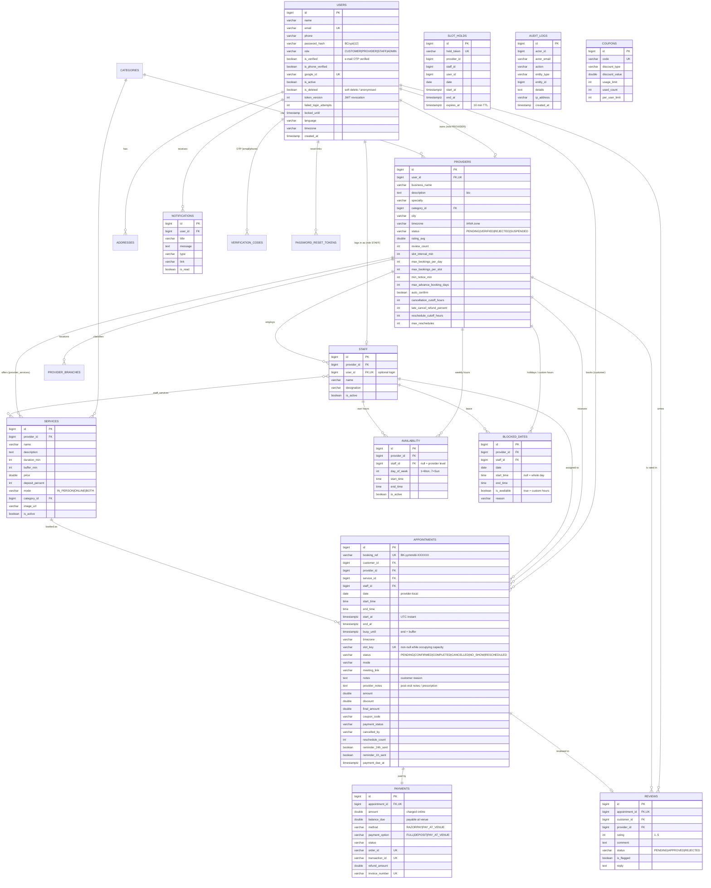

# Database schema & ER diagram

PostgreSQL 13+ (H2 in PostgreSQL mode for local runs/tests). The schema is created and versioned by
Flyway: [`backend/src/main/resources/db/migration`](../backend/src/main/resources/db/migration).
Hibernate only *validates* it (`ddl-auto: validate`).

## Mapping to the core tables in the specification

| Spec table | Implementation | Notes |
|---|---|---|
| `users` | `users` | + verification, lockout, token version, soft delete |
| `providers` | `providers` | `rating_avg`, `is_active` = `status` (VERIFIED is active) |
| `services` | `services` | + buffer, deposit %, mode (in-person / online) |
| `provider_services` | `services.provider_id` | a service is assigned to one provider; admins can re-assign or copy it to others (FR-10) |
| `availability` | `availability` | per provider or per staff member; several windows per day; slot length = service duration (+ buffer) or `providers.slot_interval_min` |
| `blocked_dates` | `blocked_dates` | whole-day, time-range or custom-hours entries |
| `appointments` | `appointments` | local date/time **and** UTC instants; `slot_key` unique constraint prevents double booking |
| `payments` | `payments` | deposit/balance, refunds, invoice number |
| `reviews` | `reviews` | moderation status, flagging, provider reply |
| `notifications` | `notifications` | in-app centre; e-mail/SMS are sent alongside |
| – | `audit_logs`, `slot_holds`, `verification_codes`, `password_reset_tokens`, `coupons`, `addresses`, `provider_branches`, `staff`, `staff_services`, `categories` | supporting tables |

**Appointment status enum** exactly as specified: `PENDING | CONFIRMED | COMPLETED | CANCELLED | NO_SHOW | RESCHEDULED`.
